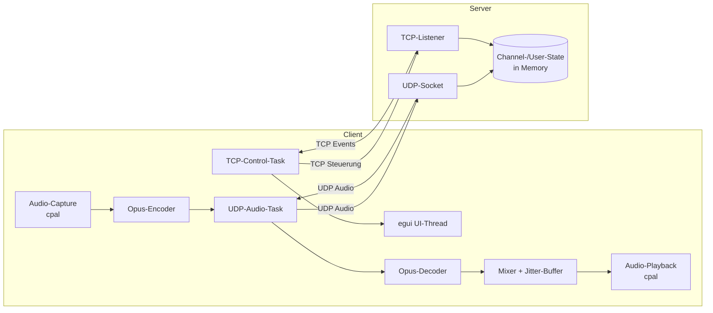

# RustTalk – Konzept

> Voice-Chat in Rust: Client wie Discord (Look & Feel), Server wie TeamSpeak (einfach, schlank, selbst-gehostet).
> Kein Account-System, keine Cloud – alles lokal bzw. auf dem eigenen Server.

---

## 1. Vision & Ziele

| Ziel | Beschreibung |
|---|---|
| **Minimaler Client** | Kleine Binary, wenige Abhängigkeiten, schneller Start |
| **Lokal-first** | Keine Online-Accounts. Username wird lokal gespeichert, Identität = pro Session |
| **Performant** | Rust, Opus-Codec, UDP-Audio, kein GC-Overhead |
| **Sprechen funktioniert** | Push-to-Talk **und** Voice-Aktivierung |
| **Discord-Optik** | Dunkles Theme, Sidebar mit Channel-Baum, Avatare, Phosphor-Icons |
| **TeamSpeak-Server** | Schlanker Server, dynamische Channels, keine Datenbank nötig |
| **Channel-Typen** | Spawn (1×, Join-Log, Sprechverbot), Kategorie (Gruppierung), Sprache (Voice + Media-Chat + Video), Text (Chat) |
| **Medien** | Bilder im Chat (persistiert); ⛔ GIPHY + Webcam/Screen-Share: kaputt, Fix in Arbeit (WIP) |

### Non-Goals (MVP)

- ❌ Video / Screenshare
- ❌ Persistente Accounts / Rollen / Rechte-System
- ❌ Verschlüsselung (LAN/Vertrauensnetzwerk; kommt später als Option)
- ❌ NAT-Traversal / Relay-Server
- ❌ Mobile Clients

---

## 2. Tech-Stack

| Bereich | Crate | Begründung |
|---|---|---|
| GUI | `eframe` / `egui` + `egui-phosphor` (Icons) | Pure Rust, dunkles Discord-Theme (immer Dark-Mode) |
| Audio I/O | `cpal` | Cross-Platform Capture/Playback |
| Codec | `audiopus` (Opus) | Standard für Voice (wie Discord/TeamSpeak), 48 kHz / 20 ms Frames |
| Rauschunterdrückung | `nnnoiseless` (RNNoise) | Pure-Rust-KI-Noise-Suppression vor dem Encoder; liefert Sprach-Wahrscheinlichkeit für VAD |
| Bilder/GIFs | `image`, `rfd` | Decoding, Datei-Dialog |
| Video (WIP, kaputt) | `nokhwa` (Kamera), `scrap` (DXGI-Screen) | MJPEG-Ansatz funktioniert nicht – Fix ausstehend |
| GIPHY (WIP, kaputt) | `ureq` + `serde_json` | Suche laeuft nicht – Fix ausstehend |
| Async Runtime | `tokio` | TCP + UDP + Tasks |
| (De)Serialisierung | `serde` + `bincode` | Kompaktes Binärprotokoll, performant |
| Ring-Buffer | `ringbuf` | Lock-free Audio-Pipeline (keine Allocs im Callback) |
| Config | `serde` + `toml` | Lokale Config-Datei |
| Logging | `tracing` + `tracing-subscriber` | Debugging auf beiden Seiten |
| Global Hotkey (später) | `global-hotkey` | PTT auch ohne Fensterfokus |

---

## 3. Architektur-Überblick



**Trennung der Verantwortlichkeiten:**

- **TCP-Steuerkanal:** Login, Channel-Beitritt, Channel erstellen/löschen, Text-Chat, User-Events (join/leave/mute/deafen). Zuverlässig, Reihenfolge garantiert.
- **UDP-Audiokanal:** Nur Opus-Frames mit kleinem Header. Verlust toleriert (lieber Lücke als Latenz).

---

## 4. Protokoll-Design

### 4.1 TCP-Steuerprotokoll

Framing: 4-Byte-Little-Endian-Länge + `bincode`-Payload.

```rust
/// Client -> Server
enum ClientMessage {
    Hello { username: String, protocol_version: u16 },
    JoinChannel { channel_id: u64 },
    CreateChannel { name: String },
    DeleteChannel { channel_id: u64 },
    RenameChannel { channel_id: u64, name: String },
    Chat { channel_id: u64, text: String },
    SetMuteState { muted: bool, deafened: bool },
    UdpRegister { token: u64 },        // verknüpft UDP-Addr mit Session
    Disconnect,
}

/// Server -> Client
enum ServerMessage {
    Welcome {
        client_id: u64,
        udp_token: u64,                // für UDP-Registrierung
        channels: Vec<ChannelInfo>,
        users: Vec<UserInfo>,
    },
    UserJoined { user: UserInfo },
    UserLeft { client_id: u64 },
    UserMoved { client_id: u64, channel_id: u64 },
    ChannelCreated { channel: ChannelInfo },
    ChannelDeleted { channel_id: u64 },
    Chat { channel_id: u64, from: String, text: String, timestamp: u64 },
    MuteStateChanged { client_id: u64, muted: bool, deafened: bool },
    Error { message: String },
}
```

### 4.2 UDP-Audioprotokoll

```
 0                   1                   2                   3
 0 1 2 3 4 5 6 7 8 9 0 1 2 3 4 5 6 7 8 9 0 1 2 3 4 5 6 7 8 9 0 1
+-+-+-+-+-+-+-+-+-+-+-+-+-+-+-+-+-+-+-+-+-+-+-+-+-+-+-+-+-+-+-+-+
|    Magic (0x5254 = "RT")      |  Version (1)  |     Flags     |
+-+-+-+-+-+-+-+-+-+-+-+-+-+-+-+-+-+-+-+-+-+-+-+-+-+-+-+-+-+-+-+-+
|                         UDP-Token (u64)                       |
+-+-+-+-+-+-+-+-+-+-+-+-+-+-+-+-+-+-+-+-+-+-+-+-+-+-+-+-+-+-+-+-+
|                        Sequence (u32)                         |
+-+-+-+-+-+-+-+-+-+-+-+-+-+-+-+-+-+-+-+-+-+-+-+-+-+-+-+-+-+-+-+-+
|                       Timestamp (u32)                         |
+-+-+-+-+-+-+-+-+-+-+-+-+-+-+-+-+-+-+-+-+-+-+-+-+-+-+-+-+-+-+-+-+
|                  Opus-Payload (variabel) ...                  |
+-+-+-+-+-+-+-+-+-+-+-+-+-+-+-+-+-+-+-+-+-+-+-+-+-+-+-+-+-+-+-+-+
```

- **Token:** Identifiziert den Sender (Server mappt Token → Client → Channel).
- **Sequence:** Für Jitter-Buffer & Packet-Loss-Erkennung.
- **Server-Forwarding:** Paket geht an alle Clients im selben Channel (außer Sender). Beim Forward wird das Token durch die `client_id` des Sprechers ersetzt.

### 4.3 Verbindungsablauf

1. Client öffnet TCP → sendet `Hello { username }` (Protokoll v3).
2. Server antwortet mit `Welcome { client_id, udp_token, channels, users, spawn_log, chat_history }`.
3. Client landet im **Spawn-Channel** (Sprechverbot) und sendet einen UDP-Registrierungs-Ping.
4. Server schreibt den Join ins Spawn-Log (persistiert) und broadcastet `SpawnLogEntry`.
5. Join nur in Spawn/Voice möglich; Audio fließt nur zwischen Mitgliedern desselben **Voice**-Channels; Chat nur in **Text**-Channels (für alle sichtbar, persistiert).

---

## 5. Audio-Pipeline

### 5.1 Capture → Send (Client)

```
Mikro (cpal, 48 kHz mono f32)
  → Ring-Buffer (lock-free)
  → Frame-Slicing (960 Samples = 20 ms)
  → RNNoise-Denoise (2× 480 Samples, i16-Bereich; abschaltbar)
  → Gate: PTT aktiv? / Voice-Aktivierung (RMS-Schwelle ODER RNNoise-Sprachwahrscheinlichkeit)?
  → Opus-Encode (Bitrate ~32–64 kbps)
  → UDP-Paket bauen & senden
```

- **PTT:** konfigurierbare Taste (MVP: solange Fenster fokussiert; später global).
- **Voice-Aktivierung:** RMS-Energie über einstellbarer Schwelle + Hysterese (Hangover ~300 ms, damit Wortenden nicht abgeschnitten werden).

### 5.2 Receive → Playback (Client)

```
UDP-Empfang
  → pro Sprecher: Jitter-Buffer (Ziel-Latenz ~60–120 ms, anhand Sequence)
  → Opus-Decode (bei Paketverlust: PLC/FEC des Opus-Decoders)
  → Mixer: Summe aller aktiven Sprecher in 20-ms-Chunks in eine 48-kHz-FIFO
    (lokal stummgeschaltete User werden uebersprungen)
  → Pull-Resampler (exakter Konsum = Abspielrate) → Playback (cpal)
```

- Keine Allocation im Audio-Callback – nur Ring-Buffer-Push/Pop.
- Lokal stummgeschaltete User (`mute`/`deafen`) werden im Mixer übersprungen.

---

## 6. Client-Design

### 6.1 UI-Layout (Discord-artig, egui)

```
┌──────────────────────────────────────────────────────────────┐
│  RustTalk – server.example.com                     [_][□][X] │
├────────────┬─────────────────────────────────────────────────┤
│ CHANNELS   │  # Allgemein – Chat                             │
│            │                                                 │
│ ▾ Server   │  [12:03] Alice: hallo                           │
│  # Allgem. │  [12:04] Bob: moin                              │
│    👤 Alice│                                                 │
│    👤 Du 🔊│  ┌─────────────────────────────────────────────┐│
│  # Gaming  │  │ Nachricht schreiben...              [Senden] ││
│    👤 Carol│  └─────────────────────────────────────────────┘│
│            │                                                 │
│ [+ Channel]│                                                 │
├────────────┴─────────────────────────────────────────────────┤
│ 👤 Username   🎙 Mute   🎧 Deafen   ⚙ Settings   ⏏ Disconnect│
└──────────────────────────────────────────────────────────────┘
```

- **Linke Sidebar:** Servername, Channel-Baum (Spawn gepinnt, Kategorien klappbar), User pro Channel (Avatar + Status)
- **Interaktion:** Klick auf Sprach-Channel = beitreten (Discord), Klick auf Text = Chat öffnen, Rechtsklick = Kontextmenü (Channel: Beitreten/Umbenennen/Löschen; User: lokale Stummschaltung)
- **Startfenster:** prozedurales Logo, Lesezeichen-Liste (gespeicherte Server) + Verbindungsformular
- **Hauptbereich:** je nach Channel-Art: Text-Chat / Spawn-Log / Sprach-Belegung
- **Bottom-Bar:** eigener Avatar+Name, Icon-Buttons (Mikro/Ton/Einstellungen/Trennen) mit Tooltips
- **Einstellungen:** separates OS-Fenster (`show_viewport_immediate`)
- **Indikatoren:** sprechender User bekommt grünen Ring/Icon (Server broadcastet „is talking“-Flag implizit über eingehende Audio-Pakete).
- **Theme:** dunkel, Discord-inspiriert (Hintergrund `#313338`, Sidebar `#2B2D31`, Akzent `#5865F2`).

### 6.2 Client-Interna

| Thread/Task | Aufgabe |
|---|---|
| UI-Thread | egui-Loop, rendert State, sendet Commands |
| TCP-Task (tokio) | Control-Messages empfangen/senden |
| UDP-Task (tokio) | Audio senden/empfangen |
| Capture-Thread (cpal) | Mikro → Ring-Buffer |
| Playback-Thread (cpal) | Mixer → Lautsprecher |

Kommunikation zwischen UI und Netzwerk über `tokio::mpsc` / `crossbeam`-Channels. Der UI-State ist eine zentrale `AppState`-Struct, die aus Server-Events aktualisiert wird.

### 6.3 Lokale Persistenz (keine Accounts!)

`config.toml` (im Arbeitsverzeichnis oder `%APPDATA%/RustTalk/`):

```toml
username = "jb"
ptt_key = "V"
voice_activation = false
vad_threshold = 0.02
input_device = "default"
output_device = "default"

[[servers]]
name = "Mein Server"
address = "127.0.0.1:7331"
```

---

## 7. Server-Design (TeamSpeak-Prinzip)

### 7.1 Eigenschaften

- **Single-Binary**, gestartet mit einer Config-Datei – fertig.
- **State in Memory + SQLite-Persistenz (optional, `persist_state`):** Channels, Text-Chat-Verlauf und Spawn-Log überleben Neustarts. Keine DB-Server-Einrichtung nötig (eine Datei, WAL-Modus).
- **Retention:** max. 10.000 Nachrichten pro Text-Channel → gedeckelte DB-Größe auch nach Jahren (5 Jahre à 100 Nachrichten/Tag ≈ 50 MB).
- **Dynamische Channels:** jeder Client darf Channels erstellen/löschen (MVP ohne Rechte). Der Spawn-Channel ist nicht löschbar.
- **Audio-Relay:** UDP-Pakete werden 1:1 an alle Channel-Mitglieder weitergeleitet (außer Sender). Kein Transcoding/Mixing auf dem Server → minimaler CPU-Verbrauch.
- **Optional:** Server-Passwort in Config (einfacher Schutz, MVP+).

### 7.2 Server-Config (`server.toml`)

```toml
bind_address = "0.0.0.0:7331"   # TCP und UDP auf gleichem Port
server_name = "Mein RustTalk Server"
max_clients = 32
# password = "geheim"           # optional
persist_state = true            # SQLite: Channels, Chat, Spawn-Log
db_path = "/opt/rusttalk/server/rusttalk.db"

[[channels]]                    # kind: spawn | category | text | voice
name = "Spawn"
kind = "spawn"

[[channels]]
name = "Text"
kind = "category"

[[channels]]
name = "allgemein"
kind = "text"
category = "Text"
```

### 7.3 Persistenz (SQLite)

```
Server/db.rs
 ├── channels  (id, name, kind, parent)          – upsert/delete bei Channel-Aktionen
 ├── messages  (channel_id, from_name, text, ts) – jede Text-Chat-Nachricht;
 │                                                 Retention: letzte 10.000 je Channel
 └── events    (ts, text)                        – Spawn-Log (Joins)
```

- Beim Start: Config-Channels ∪ DB-Channels (Union per Name+Art, IDs gemappt), Spawn-Log geladen.
- Beim Login: `Welcome` enthält `chat_history` (letzte 100 Nachrichten je Text-Channel) → Client sieht Verlauf sofort.
- Ohne `persist_state = true` bleibt alles rein flüchtig (Tests, LAN-Party-Modus).

```
main.rs
 ├── TCP-Listener-Task  → pro Verbindung ein Connection-Task
 ├── UDP-Socket-Task    → demultiplext anhand Token
 └── State (Arc<RwLock<ServerState>> oder Actor via mpsc)
```

---

## 8. Projektstruktur (Cargo-Workspace)

```
RustTalk/
├── Cargo.toml                  # Workspace (shared, Server, Client/Windows)
├── Konzept.md
├── test.md                     # Testprotokoll
├── shared/                     # Gemeinsamer Code (Client + Server)
│   └── src/
│       ├── lib.rs
│       ├── protocol.rs         # ClientMessage / ServerMessage (serde)
│       ├── framing.rs          # Length-Prefixed-Framing über TCP
│       └── audio_packet.rs     # UDP-Header encode/decode
├── Server/                     # Linux-Server (Ziel: Debian)
│   ├── src/
│   │   ├── main.rs             # Entry, Config laden, TCP+UDP starten
│   │   ├── config.rs           # server.toml
│   │   ├── state.rs            # ServerState (Clients, Channels) in Memory
│   │   ├── tcp.rs              # Listener + Connection-Tasks
│   │   ├── udp.rs              # Audio-Relay
│   │   └── bin/test_client.rs  # Headless CLI-Testclient (E2E)
│   ├── tests/integration.rs    # End-to-End-Tests (synthetische Clients)
│   ├── deploy/                 # systemd-Unit + install_service.sh
│   └── Test_Scripts/           # run_tests.sh, e2e_local.sh
└── Client/
    └── Windows/                # Windows-Client (egui)
        ├── src/
        │   ├── main.rs         # Entry, eframe-Setup
        │   ├── app.rs          # AppState + egui-Layout
        │   ├── net.rs          # TCP-/UDP-Tasks
        │   ├── audio/
        │   │   ├── mod.rs      # AudioEngine (Start/Stop)
│       │   │   ├── capture.rs  # cpal Input + Mono-Mixdown
│       │   │   ├── resample.rs # linearer Resampler auf/von 48 kHz
│       │   │   ├── encoder.rs  # PTT/VAD-Gate + Opus-Encode
│       │   │   ├── playback.rs # Mixer + cpal Output
│       │   │   └── jitter.rs   # Jitter-Buffer pro Sprecher
│       │   └── config.rs       # client_config.toml
│       └── Test_Scripts/       # cargo.ps1 (WDAC-Wrapper), run_tests.ps1, e2e_server.ps1
```

> Crate-Namen bleiben lowercase (`rusttalk-shared`, `rusttalk-server`, `rusttalk-client`),
> die Ordner spiegeln die Zielplattform: `Server/` → Linux (Debian), `Client/Windows/` → Windows.

---

## 9. MVP-Scope & Phasen

### Phase 1 – Lauffähiges MVP (Ziel des Oneshot)

- [ ] Workspace mit `shared`, `client`, `server`
- [ ] TCP-Handshake (`Hello`/`Welcome`), User-Liste, Join/Leave-Broadcasts
- [ ] UDP-Audio-Pipeline: Capture → Opus → UDP → Relay → Decode → Playback
- [ ] Push-to-Talk (fokussiertes Fenster)
- [ ] egui-Grundlayout: Sidebar (Channels+User), Bottom-Bar (Mute/Deafen)
- [ ] Feste Channels aus Server-Config, Default-Channel-Join

### Phase 2 – Vollständiges Konzept-Feature-Set

- [ ] Dynamische Channels (erstellen/löschen/umbenennen)
- [ ] Text-Chat pro Channel
- [ ] Voice-Aktivierung (RMS + Hysterese, Threshold im UI einstellbar)
- [ ] Lokales Mute/Deafen pro User + eigener Mute/Deafen-Broadcast
- [ ] Settings-Dialog (Audio-Devices, PTT-Taste, VAD)

### Phase 3 – Polish (nach dem Oneshot)

- [ ] Globaler PTT-Hotkey (`global-hotkey`)
- [ ] „Spricht gerade“-Indikator (grüner Ring)
- [ ] Jitter-Buffer-Tuning, Opus-FEC aktivieren
- [ ] Server-Passwort, Auto-Cleanup leerer Channels
- [ ] Verschlüsselung (z. B. Umstieg auf QUIC/`quinn` oder DTLS)

---

## 10. Definition of Done (Oneshot-Kriterien)

Der Oneshot gilt als erfolgreich, wenn:

1. `cargo build --release` im Workspace ohne Fehler durchläuft (Windows + Debian).
2. Server startet mit `server.toml`, zwei Client-Instanzen können sich verbinden.
3. Beide Clients sehen sich in der User-Liste des Default-Channels.
4. PTT auf Client A ist auf Client B verständlich hörbar (Latenz < 200 ms im LAN).
5. Channels können zur Laufzeit erstellt und betreten werden.
6. Text-Chat funktioniert pro Channel.
7. Kein `unsafe`, kein Panic-Pfad im Normalbetrieb, Audio-Callback allocation-frei.
8. `cargo test` läuft grün (Unit- + Integrationstests, siehe Abschnitt 12).
9. Server läuft als systemd-Service auf dem Debian-Ziel und ist aus dem LAN erreichbar.
10. [test.md](test.md) dokumentiert alle durchgeführten Tests und deren Ergebnisse.

---

## 11. Offene Punkte / Entscheidungen

| Frage | Vorschlag | Status |
|---|---|---|
| Gleicher Port für TCP+UDP? | Ja (`7331`), vereinfacht Firewall-Setup | ✅ entschieden |
| Wer darf Channels löschen? | MVP: jeder; später Rechte | ✅ entschieden |
| Verschlüsselung? | MVP nein (LAN), später QUIC | ✅ entschieden |
| Max. Sprecher gleichzeitig? | Kein Limit im MVP, Mixer summiert alles | offen |
| Akustik-Echokompensation (AEC)? | Nein im MVP → Kopfhörer empfehlen; später `webrtc-audio-processing` evaluieren | offen |

---

## 12. Test-Strategie

| Ebene | Was | Wo |
|---|---|---|
| **Unit-Tests** (`cargo test`) | Protokoll-Roundtrip, UDP-Paket Encode/Decode, Jitter-Buffer-Ordering, VAD-Gate, Resampler, Config-Roundtrip | je Crate inline |
| **Integrationstests** | Echter Server-Prozess + 2 synthetische Clients (test_client-Binary): Handshake, Channel-Management, Chat-Routing, Mute-Broadcast, Passwort, Audio-Relay | [Server/tests/](Server/tests/) |
| **E2E über LAN** | 2× `test_client` vom Windows-Rechner gegen den Debian-Server | [e2e_server.ps1](Client/Windows/Test_Scripts/e2e_server.ps1) |
| **Manuell** | GUI-Client auf Windows: Sprache, PTT, Channel-Wechsel, Mute/Deafen – Checkliste in [test.md](test.md) | Client/Windows |

- **Test-Skripte:** Shell unter [Server/Test_Scripts/](Server/Test_Scripts/), PowerShell unter [Client/Windows/Test_Scripts/](Client/Windows/Test_Scripts/).
- **Windows-Besonderheit (WDAC):** Auf diesem Rechner blockiert WDAC cargo-Build-Skripte, wenn cwd oder Manifest unter `Documents` liegen (os error 4551). Deshalb baut/testet alles über [cargo.ps1](Client/Windows/Test_Scripts/cargo.ps1) (spiegelt nach `%LOCALAPPDATA%\Programs\RustTalk-src`, Retry bei transienten Blocks).
- **Dokumentation:** Jeder Testlauf wird mit Datum, Umgebung und Ergebnis in [test.md](test.md) festgehalten.
- **Vorgehen:** Nach Implementierung Tests ausführen, Fehler direkt nachbessern, dann test.md aktualisieren.
